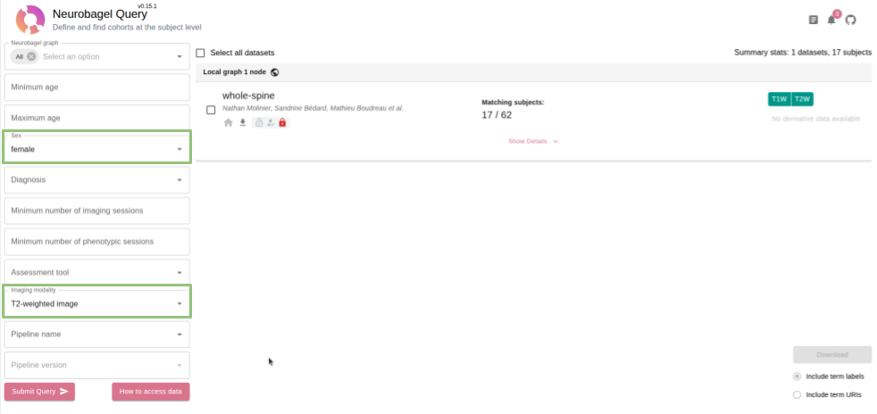
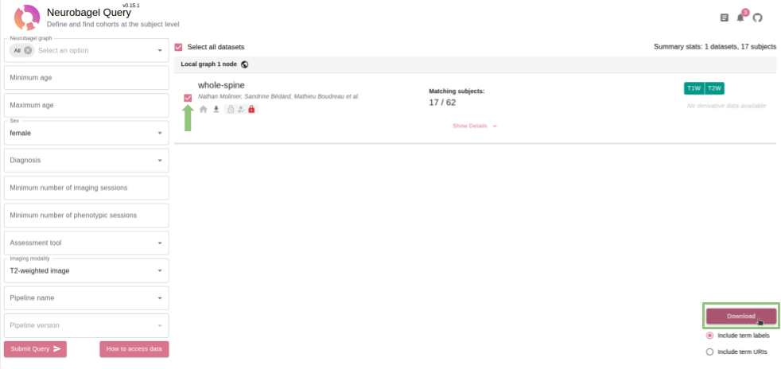

# Find data

Use the Neurobagel website to search all lab datasets at once.

> [!NOTE]
> You need the **VPN** (off campus) and to be a member of the **[neuropoly GitHub organization](https://github.com/neuropoly)**. See [Get access](get-access.md).

## Search and export

1. Open <https://data.neuro.polymtl.ca/bagel>.
2. Set any of the filters on the left of the page (age, sex, diagnosis, imaging modality, etc.), then select
   **Submit Query**. Leave filters empty to list all datasets.

   

3. Select the datasets to include. Each card shows matching subjects and scan types.

4. Select **Download** at the bottom right. Keep **Include term labels** selected.

   

5. Save the `.tsv` results file in your data folder, for example `~/neuropoly-data`.

## Results file reference

| Column | Meaning |
|--------|---------|
| `DatasetName` | Dataset the subject belongs to. |
| `SubjectID`, `SessionID` | Subject and session. |
| `Age`, `Sex`, `Diagnosis` | Subject information. |
| `SessionImagingModalities` | Types of scans in that session (`T1w`, `T2w`, ...). |

Move this file to your data folder (e.g. `~/neuropoly-data`).

Next: [Download data](download-data.md)
