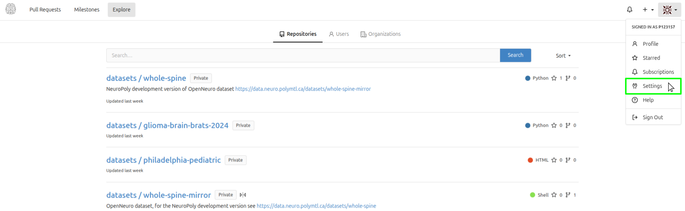
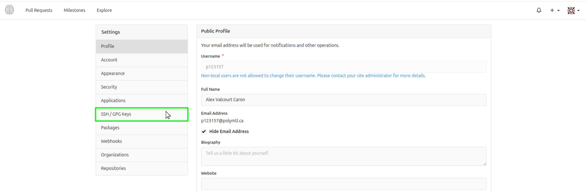
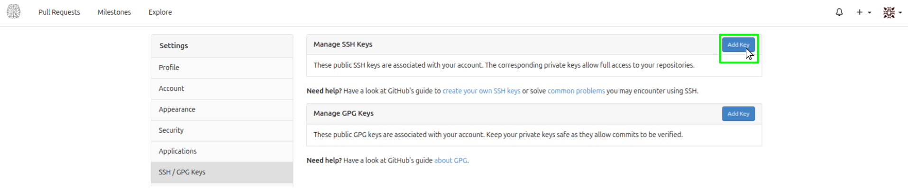
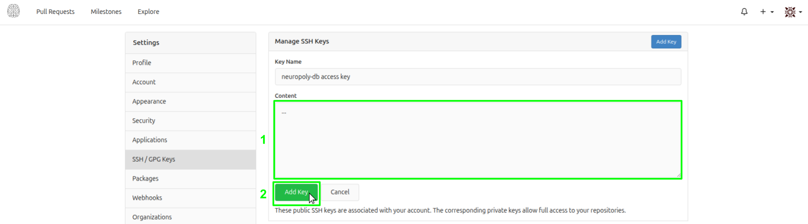
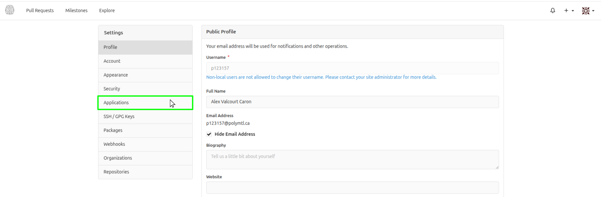
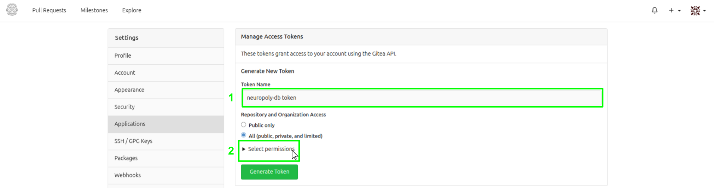
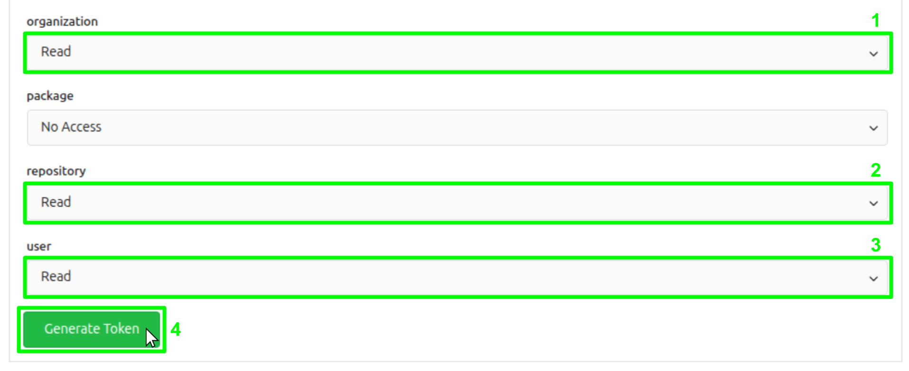
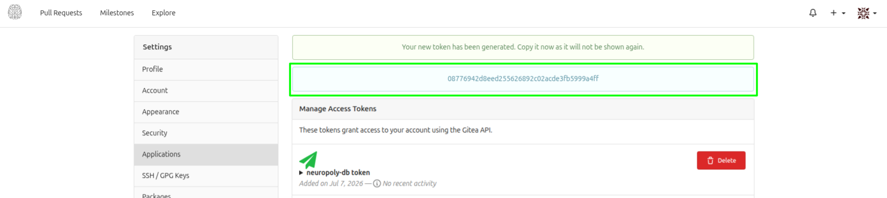

# Get access

You do this **once**. It takes about 15 minutes.

- [Get access](#get-access)
  - [1. VPN and GitHub](#1-vpn-and-github)
  - [2. NeuroData account](#2-neurodata-account)
  - [3. Register your computer (SSH key)](#3-register-your-computer-ssh-key)
  - [4. Create a download token](#4-create-a-download-token)
  - [5. Save your credentials](#5-save-your-credentials)

## 1. VPN and GitHub

- Connect to the Polytechnique VPN when off campus.
- Join the [neuropoly GitHub organization](https://github.com/neuropoly).
  Ask your supervisor or lab admins if you are not a member.

## 2. NeuroData account

1. Log in at <https://data.neuro.polymtl.ca>. For an account, contact
   [NeuroPoly IT support](https://github.com/orgs/neuropoly/teams/ansible-admins).
2. Open your profile picture menu, then **Settings**.

   

## 3. Register your computer (SSH key)

Complete this section on each computer used to download data. This is required to
get access to large files indexed with `git-annex` in NeuroData..

1. Check authentication:

   ```bash
   ssh git@data.neuro.polymtl.ca
   ```

   If the response includes `You've successfully authenticated`, continue to
   [Create a download token](#4-create-a-download-token).

2. Check for an existing public key:

   ```bash
   ls ~/.ssh/id_ed25519.pub
   ```

   If absent, create a key without overwriting an existing one:

   ```bash
   ssh-keygen -t ed25519
   ```

3. Copy your public key:

   ```bash
   cat ~/.ssh/id_ed25519.pub
   ```

4. In NeuroData settings, click **SSH / GPG Keys**, then **Add Key** (next to *Manage SSH Keys*).

   

   

5. Paste the key in **Content**, then click **Add Key**.

   

6. Repeat the authentication check from step 1.

## 4. Create a download token

A download token is required to give secure access to the `git` repositories in NeuroData, outside of large files.

1. In NeuroData settings, open **Applications**.

   

2. Name the token (e.g. `npdb`), then click **Select permissions**.

   

3. Set **organization**, **repository**, and **user** to **Read**, then
   select **Generate Token**.

   

4. **Copy the token now.** It is shown only once. You'll need it below at step 5.2.

   

## 5. Save your credentials

1. Create your data folder and open a credentials file:

   ```bash
   mkdir -p ~/neuropoly-data
   cd ~/neuropoly-data
   nano .env
   ```

2. Save these values with your username and token:

   ```bash
   NP_GITEA_APP_URL=https://data.neuro.polymtl.ca
   NP_GITEA_APP_USER=your-username
   NP_GITEA_APP_TOKEN=paste-your-token-here
   ```

3. Save and close the editor. Restrict access:

   ```bash
   chmod 600 .env
   ```

**Run downloads from this folder. Never share or commit the token or `.env`.**

Next: [Install npdb](install.md).
